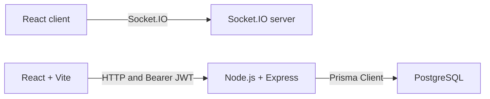

# Teco Architecture Overview

Teco has a React + Vite client, an Express API, JWT authentication, and PostgreSQL access through Prisma. The authenticated chat UI loads persisted friends, friend requests, conversations, and messages. Socket.IO provides realtime delivery for persisted direct messages.

## Current Request Path



The browser does not connect directly to PostgreSQL. The server owns authentication, database access, HTTP responses, and authorized Socket.IO rooms.

## Repository Layout

```text
Teco/
├── client/                 # React application and browser routes
├── server/                 # Express API and Prisma integration
│   ├── prisma/             # Schema, migrations, and seed script
│   └── src/                # Routes, controllers, services, middleware
├── docs/                   # Current behavior and proposed designs
├── docker-compose.yml      # Local PostgreSQL and Adminer
├── .env.example
└── README.md
```

## Responsibilities

| Area | Responsibility |
| --- | --- |
| `client/` | Registration/login, route guards, DB-backed friend and conversation views, and Socket.IO chat. |
| `server/` | Authenticated API endpoints, JWT verification, Socket.IO authorization, and Prisma-backed operations. |
| `server/prisma/` | Database schema, committed migrations, and a local seed script. |
| PostgreSQL | Persistent user, conversation, participant, and message records. |

## Implemented API

| Method | Route | Access |
| --- | --- | --- |
| `POST` | `/api/auth/register` | Public |
| `POST` | `/api/auth/login` | Public |
| `GET` | `/api/user/me` | JWT required |
| `GET` | `/api/user/details` | JWT required |
| `GET` | `/api/friends` | JWT required |
| `GET` | `/api/friend-request/pending` | JWT required |
| `POST` | `/api/conversations` | JWT required; accepted friends only |
| `GET` | `/api/conversations/:conversationId/messages` | JWT required; participants only |
| `GET` | `/health` | Public |

All `/api/user` routes use JWT middleware. See [Authentication flow](authFlow.md) for request and response details.

## Design Documents

- [Frontend architecture](frontend.md)
- [Backend architecture](backend.md)
- [Database design](database.md)
- [New chat flow](new-chat-flow.md)
- [Message lifecycle](messageLifeCycle.md)
- [Socket.IO chat](socket.md)

## V1 Boundary

V1 supports one-to-one conversations between accepted friends. Group chat remains a later extension.
## V2: Group Chat

V2 can add a conversation type, group name and avatar, more than two participants, member-management actions, participant roles, and group-specific UI and authorization. These additions extend the same client → server → Prisma → PostgreSQL architecture.
