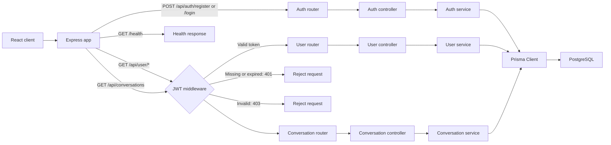

# Backend Architecture

The `server/` package is a Node.js and Express API with JWT-protected friends, friend requests, direct and group conversations, message history, and Socket.IO message delivery. PostgreSQL data is accessed through Prisma.

## Technology

- Node.js and Express
- TypeScript
- Prisma Client with the PostgreSQL adapter
- bcrypt for password hashing
- jsonwebtoken for access tokens
- Socket.IO for authenticated realtime message delivery

## Current Structure

```text
server/
├── prisma/
│   ├── schema.prisma
│   ├── seed.ts
│   └── migrations/
└── src/
    ├── controllers/        # HTTP request/response handling
    ├── lib/                # JWT and Prisma clients
    ├── middleware/domain/  # Authentication and domain errors
    ├── routes/             # Auth, user, and conversation route registration
    ├── services/           # Auth, user, friendship, conversation, and group operations
    ├── types/
    ├── socket.ts           # Authenticated conversation rooms and live messages
    ├── app.ts              # Express middleware and routes
    └── server.ts           # Environment loading, HTTP, and Socket.IO startup
```

## Request Flow



Controllers translate HTTP inputs and results. Services contain the database operations. The browser never accesses Prisma or PostgreSQL directly.

## Implemented Routes

| Method | Endpoint | Access | Behavior |
| --- | --- | --- | --- |
| `GET` | `/health` | Public | Returns a simple server health response. |
| `POST` | `/api/auth/register` | Public | Hashes the password and creates a user. |
| `POST` | `/api/auth/login` | Public | Verifies credentials and returns user ID, email, and JWT. |
| `GET` | `/api/user/me` | JWT required | Returns the current user's safe profile. |
| `GET` | `/api/user/details` | JWT required | Returns safe details for all users. |
| `GET` | `/api/conversations` | JWT required | Lists conversations containing the authenticated user, counterpart names, and the latest message preview. Each conversation includes `id`, `createdAt`, and `updatedAt`. |
| `POST` | `/api/conversations` | JWT required | Creates or returns a direct conversation for `friendId`; only accepted friends can start a conversation. |
| `GET` | `/api/conversations/:conversationId/messages` | JWT required | Returns up to 100 messages in chronological order to a conversation participant. |
| `GET` | `/api/groups` | JWT required | Lists the user's groups, members, role assignments, and latest message. The four default rooms are joined automatically. |
| `POST` | `/api/groups` | JWT required | Creates a private group with the caller as owner and selected registered users as members. |
| `PATCH` | `/api/groups/:groupId` | JWT required | Owner can update group details, members, and admins. Admins can update the description and manage regular members. |
| `DELETE` | `/api/groups/:groupId` | JWT required | Deletes an owner-managed private group and its messages. Default rooms cannot be edited or deleted. |
| `GET` | `/api/friends` | JWT required | Returns the authenticated user's accepted friends with `id`, `name`, `email`, and `createdAt`; returns `[]` when there are none. |
| `GET` | `/api/friend-request/pending` | JWT required | Lists incoming pending friend requests with sender name and email. |
| `POST` | `/api/friend-request/send` | JWT required | Sends a friend request to the user identified by `receiverId`. |
| `POST` | `/api/friend-request/accept` | JWT required | Accepts the request identified by `requestId`. |
| `POST` | `/api/friend-request/decline` | JWT required | Deletes a pending request addressed to the authenticated user. |

All `/api/user`, `/api/conversations`, `/api/groups`, `/api/friends`, and `/api/friend-request` routes pass through `authenticateToken`. Missing or expired tokens receive `401`; invalid tokens receive `403`. The middleware attaches the verified token payload to `req.user`, which protected services use to limit results to the signed-in user.

New users are added transactionally to the four default rooms: World Chat, Tech & Code, English Corner, and Love & Vibes. Existing users are enrolled when their group list is first loaded. Group roles are stored on conversation participants; message history and realtime delivery require current membership.

## Authentication and Errors

- Passwords are stored as bcrypt hashes, not plaintext.
- `JWT_SECRET` must be set and non-empty before the server starts.
- Access tokens contain `userId` and `email`; the default expiry is one day.
- Duplicate registration responds with `409`; unexpected registration errors respond with `500`.
- Invalid login credentials respond with `401`.

The current implementation uses direct controller error responses. A shared validation and error-handling layer is future cleanup; the broader error-handling approach described in the design backlog is not yet implemented.

## Environment and Local Startup

The server loads its environment from `server/.env` when run from the server package. Create the root environment from the example, set a private `JWT_SECRET`, and copy it into the server package:

```bash
cp .env.example .env
# Edit .env and replace JWT_SECRET with a private random value.
cp .env server/.env
docker compose up -d
cd server
npm ci
npx prisma migrate deploy
npx prisma generate
npm run dev
```

The app-level Prisma client reads `DATABASE_URL`. Prisma CLI settings and schema paths are defined in `server/prisma.config.ts`.

## Planned Server Work

Related implementation details:

- [New chat flow](new-chat-flow.md)
- [Message lifecycle](messageLifeCycle.md)
- [Socket.IO design](socket.md)

Messages are persisted before they are broadcast through Socket.IO. Conversation history and socket room membership both enforce participant membership.
