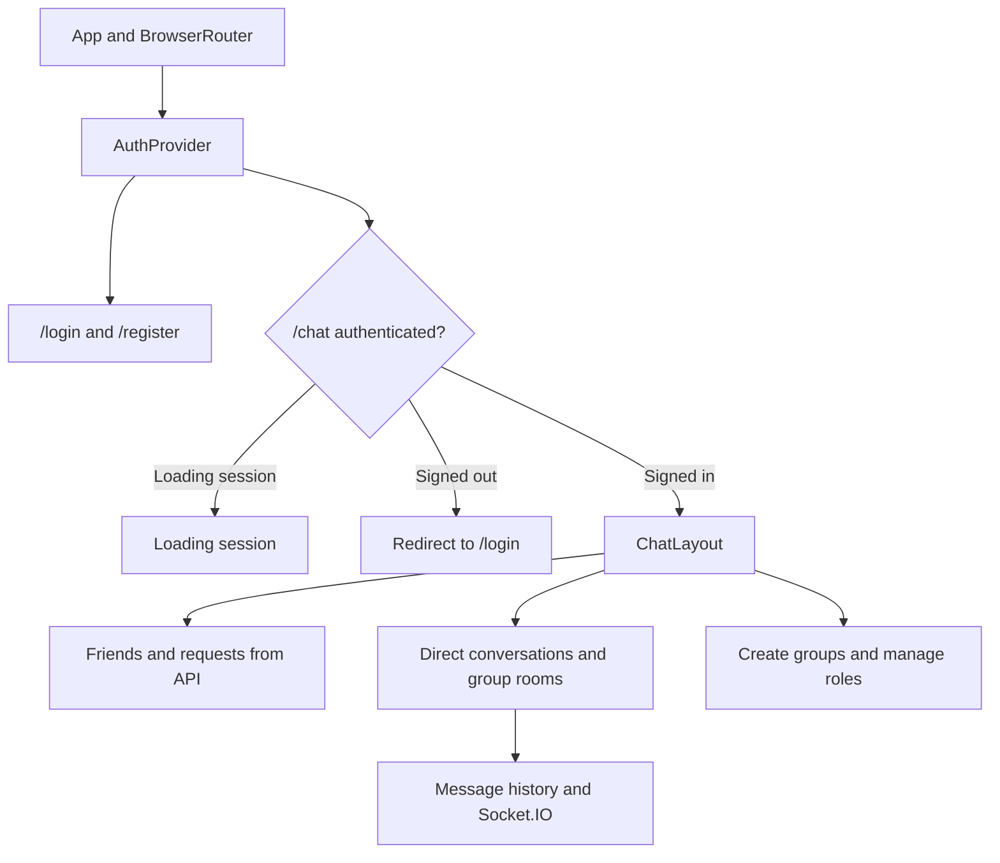

# Frontend Architecture

The `client/` package is a React, TypeScript, and Vite browser application. It implements registration/login, shared auth state, protected routes, DB-backed friend and request lists, conversation history, group management, and Socket.IO messages.

## Current Routes

| Route | Access | Current behavior |
| --- | --- | --- |
| `/` | Public | Redirects to `/login`. |
| `/register` | Public | Displays the account registration form. |
| `/login` | Public | Displays the login form; authenticated users are redirected to `/chat`. |
| `/chat` | Protected | Displays friends, requests, persisted conversations, default group rooms, and realtime direct and group chat. |
| `*` | Public | Displays a not-found message. |

`ProtectedRoute` redirects unauthenticated users to `/login`. The server remains responsible for validating tokens and protecting API data.

## Authentication State

`AuthProvider` exposes the user, token, loading/authenticated state, and `signIn`/`signOut` actions. After a successful login, the form passes the returned user and token to `signIn`. The provider updates React state and persists the token in `localStorage`.

On startup, the provider checks a stored token with `GET /api/user/me`. It restores the user when the request succeeds and clears the local session when verification fails. Logout clears both context state and the persisted token.

## HTTP API Layer

`src/lib/api/apiClient.ts` centralizes browser requests. It uses `VITE_API_URL` when provided and otherwise defaults to `http://localhost:3000`. It attaches the token from `localStorage` to non-auth requests, parses JSON responses, and throws for non-success HTTP responses. `src/services/` contains auth and user request functions.

Vite reads environment overrides from the client package directory, for example `client/.env.local`; the root `.env` is used by Docker Compose and is not automatically loaded by Vite.

## Current UI Composition

The theme toggle is held in `App`. Chat layout loads friends, incoming requests, conversations, and group memberships from authenticated APIs. Group settings expose owner/admin actions while the server enforces the same permissions. The active chat loads persisted history and opens an authenticated Socket.IO connection for live delivery.

## Chat Data Flow

Typed service functions call the HTTP API. The server persists messages and broadcasts them to authorized conversation rooms. The client reloads history after reconnecting and deduplicates messages by database ID. In group messages, a purple crown marks the owner, a red symbol marks admins, and a member dot marks regular members.
