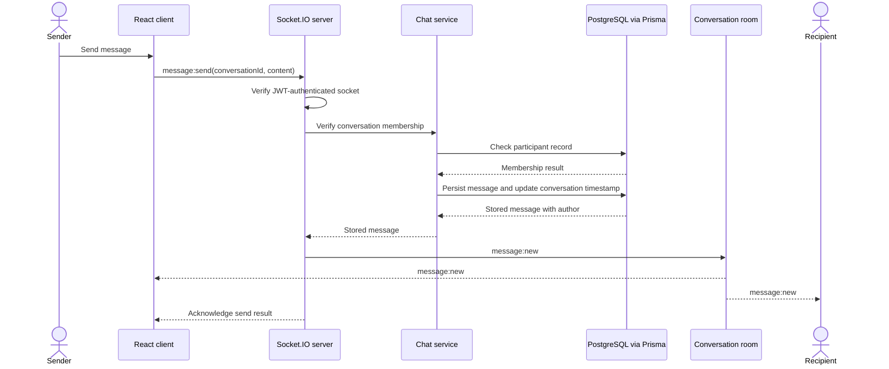

# Message Lifecycle

Direct messages are stored in PostgreSQL before the server broadcasts them to the conversation's Socket.IO room.

## History and Reconnection

On opening a conversation, the client loads up to the latest 100 messages from `GET /api/conversations/:conversationId/messages`. The endpoint returns messages chronologically and only to a participant. On socket reconnection, the client reloads history to recover messages sent while disconnected. Live messages are deduplicated by their persisted IDs.

## Failure Behavior

- Invalid or missing JWT: Socket.IO rejects the connection.
- Nonparticipant room join or message send: the server rejects the action.
- Empty or over-4000-character content: the server rejects the message.
- Database failure: no `message:new` event is emitted; the sender receives an error acknowledgement.
