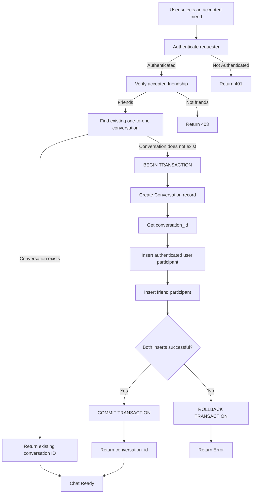

This is the implemented flow for opening a one-to-one conversation with an accepted friend.

Messages are loaded from the participant-protected history endpoint. New messages are sent through the authenticated Socket.IO connection, stored by the server, and then broadcast to the conversation room.
