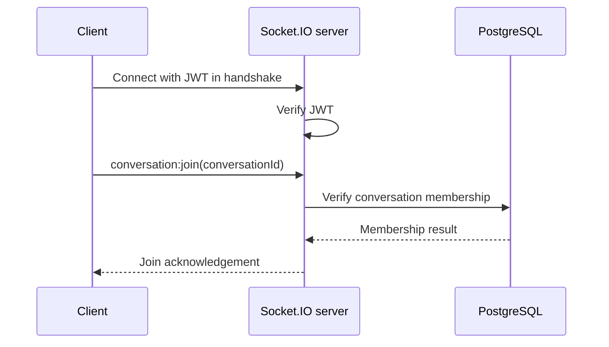
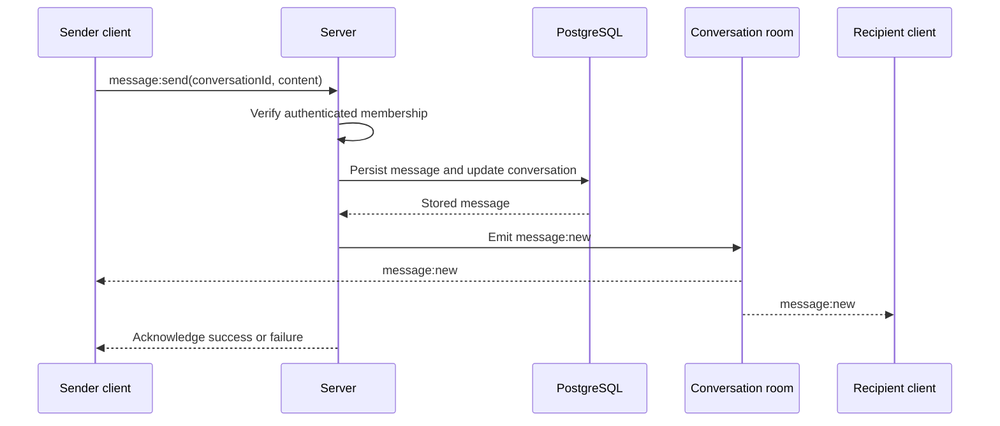

# Real-Time Socket.IO Chat

Socket.IO delivers direct messages after the server authorizes and persists them. Conversation history and friend data remain in PostgreSQL.

## Connection and Authorization

The client opens a Socket.IO connection while a conversation is active and sends its JWT in the handshake auth payload. The server verifies the token before accepting the socket. Each conversation room is joined explicitly; the server checks that the authenticated user is a participant before joining.

The client cannot choose a user ID, room name, or membership. The server derives the user ID from the verified JWT and joins the socket to `conversation:<conversationId>` only after checking the database.

## Events

| Event | Direction | Payload / behavior |
| --- | --- | --- |
| `conversation:join` | Client → server | A conversation ID; acknowledged only after membership is verified. |
| `message:send` | Client → server | Conversation ID and 1-4000 characters of message content. |
| `message:new` | Server → room | The persisted message, including ID, author, and creation time. |
| `connect_error` | Server → client | Connection or authentication failure. |

## Message Delivery

The server stores the message in a database transaction before broadcasting it. Messages are not optimistically fabricated in the client. Message history is loaded from the authenticated `GET /api/conversations/:conversationId/messages` endpoint; the client deduplicates live events by message ID and reloads history after reconnecting.

## Conversation Lifecycle

The client creates or opens a direct conversation through `POST /api/conversations` with `friendId`. The backend derives the requesting user from the JWT and permits creation only for an accepted friendship. The client disconnects its conversation socket when the chat view unmounts.

## Operational Notes

- Set `CLIENT_URL` to the browser application's origin for Socket.IO CORS.
- Socket messages are limited to 4000 characters.
- Only authenticated conversation participants can load history, join rooms, or send messages.
- Group chat is not currently supported.
